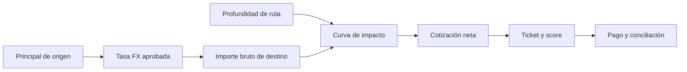
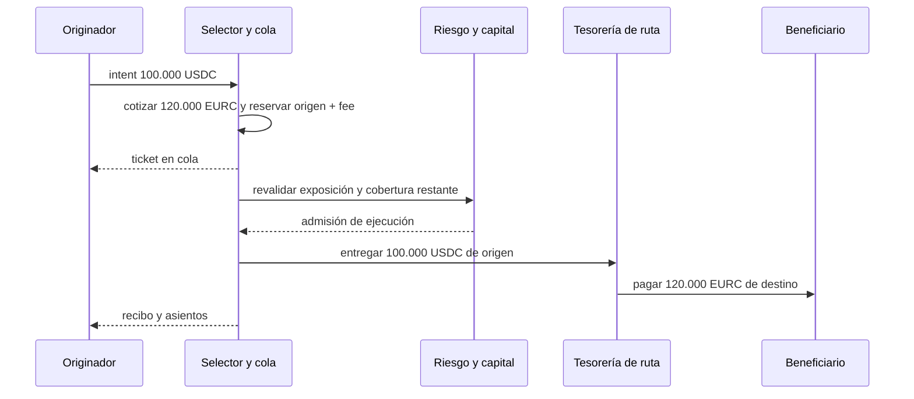
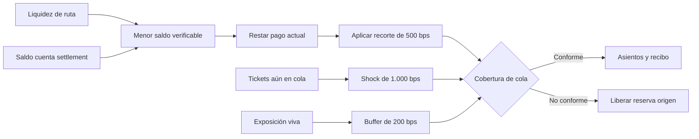

# Cotización FX y cobertura de cola

CompassDTL separa la financiación del originador del pago al beneficiario. Cada ruta fija un activo de origen, uno de destino y una tasa `fxRatePpm`. La tasa 1.000.000 representa paridad numérica; por ejemplo, 1.200.000 transforma 100.000 unidades de origen en 120.000 unidades de destino. El cálculo usa enteros y redondea hacia abajo. Las comisiones se calculan sobre el importe de origen y se reservan en ese mismo activo.

```text
debito_reservado_origen = principal_origen + comisiones_origen
bruto_destino = floor(principal_origen × fxRatePpm / 1.000.000)
cotizacion_neta = bruto_destino - cargo_de_inventario
liquidez_ruta_posterior = liquidez_ruta_anterior - cotizacion_neta
```

La tasa configurada debe quedar entre 500.000 y 2.000.000 ppm. Expresa una relación entre unidades menores de los dos activos: la normalización de sus decimales debe estar incorporada en la tasa aprobada. Una ruta del mismo activo solo admite paridad numérica. La selección descarta rutas sin liquidez suficiente para el pago cotizado. El score de liquidez compara el importe de destino con la liquidez de la ruta. El ticket conserva la cotización junto a su ruta y no puede cambiar el importe en ejecución sin volver a comprobar esa relación.

## Impacto de inventario

Una ruta puede activar `liquidityImpactBps` entre 0 y 5.000 bps. El motor parte del importe bruto convertido y aplica un ajuste no lineal que depende del tamaño de la orden y de la profundidad disponible. La cotización neta, no el bruto, es la obligación de pago registrada en el ticket. El ajuste se calcula con enteros y la carga se redondea hacia arriba. Con impacto cero, el pago vuelve a la conversión FX simple.

Como ejemplo de dimensionamiento, una ruta con 1.000.000 unidades de destino, tasa de paridad, impacto de 5.000 bps y una orden de 500.000 unidades de origen cotiza 375.000 unidades de destino. El cargo de inventario es 125.000: el 50 % de las 500.000 unidades brutas ponderado por el uso del 50 % de la profundidad. Tras liquidar, la ruta mantiene 625.000 unidades de destino. Los parámetros de impacto y FX son controles de tesorería; deben revisarse juntos con el margen comercial y el riesgo de inventario.





## Protección de tickets pendientes

Antes de pagar, el motor vuelve a consultar límites vivos por ruta y corredor. La admisión y la reserva de exposición se hacen bajo el mismo bloqueo del libro de riesgo. Cuando siguen pendientes tickets de esa ruta, se evalúa la liquidez que quedará después del pago actual, usando el menor valor entre liquidez publicada y saldo real de settlement. El cálculo incorpora un recorte del 5 %, shock de salida del 10 % y buffer del 2 % sobre la exposición. Si el resultado no cumple, el ticket se rechaza y se libera la reserva del originador.



Ejemplo operativo: una ruta dispone de 300.000 unidades de destino y recibe dos tickets de 100.000 unidades de origen cada uno con tasa 1.200.000 ppm. Cada pago cotizado es 120.000 unidades de destino. Tras el primero quedan 180.000; el segundo puede liquidar y deja 60.000. El libro de riesgo registra 200.000 unidades de principal de origen distribuidas entre los dos settlements. En caso de rechazo o expiración, el importe reservado del ticket no se transforma en un pago: vuelve al saldo disponible de su originador.

La cobertura de una cola es un control de ejecución, no una garantía absoluta de solvencia. Las reservas del proveedor, la liquidez de ruta, el libro de riesgo y los recibos deben conciliarse por activo y por epoch. Los indicadores agregados HHI y los escenarios de stress ayudan a planificar límites, pero no sustituyen esa conciliación.
